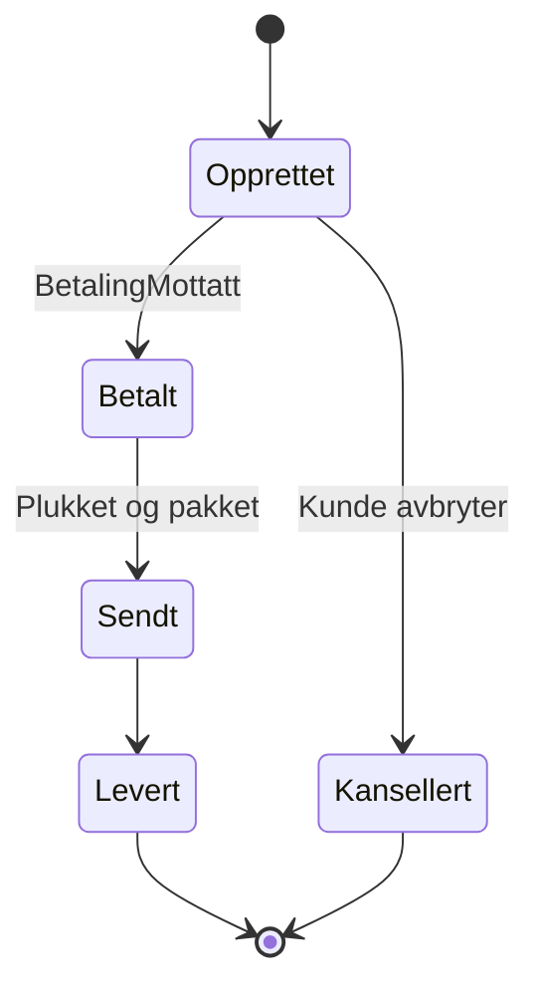

---
aliases:
  - Bestilling
  - Order
relatert:
  - "[[Kunde]]"
  - "[[Betaling]]"
eier: Team Handel
---
# Ordre

En **ordre** (alias *bestilling*) er en [[Kunde]]s forpliktende bestilling av én eller flere ordrelinjer.

## Livssyklus



## Hendelser

Når en ordre opprettes publiseres [[ordre-opprettet]] på Kafka. Når [[Betaling]] er mottatt, går ordren til `BETALT`.

## Tabell

```sql
CREATE TABLE ordre (
    ordre_id     UUID PRIMARY KEY,
    kunde_id     UUID        NOT NULL REFERENCES kunde (kunde_id),
    status       VARCHAR(20) NOT NULL CHECK (status IN ('OPPRETTET','BETALT','SENDT','LEVERT','KANSELLERT')),
    opprettet    TIMESTAMPTZ NOT NULL DEFAULT now()
);
```
