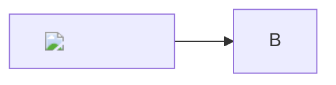

# Sikkerhet – ondsinnet HTML

**Forventet (AK20):** Ingen `alert` skal noen gang dukke opp. Ingen nettverkskall ut (B10). Farlig HTML fjernes eller vises som tekst; ufarlig HTML (`<kbd>`, `
`, `<mark>`, ``, ``) kan beholdes.

## Script-tagger

## Hendelsesattributter

Hold musepekeren over meg

<svg onload="alert('svg-onload')"><circle r="10"/></svg>

details med ontoggle
Innhold

## Farlige URL-er

<a href="javascript:alert('href')">HTML-lenke med javascript:</a>

[Markdown-lenke med javascript:](javascript:alert('md-lenke'))

[Markdown-lenke med data:](data:text/html;base64,PHNjcmlwdD5hbGVydCgxKTwvc2NyaXB0Pg==)

<a href="JaVaScRiPt:alert('blandet-case')">Blandet case</a>

<a href="&#106;avascript:alert('entitet')">HTML-entitet</a>

## Innbygging og stil

<iframe src="https://example.com"></iframe>

<object data="https://example.com/x.swf"></object>

<embed src="https://example.com/x.swf">

Overlegg som dekker hele siden

<form action="https://example.com/stjel"><input name="passord" type="password"><button>Logg inn</button></form>

<meta http-equiv="refresh" content="0;url=https://example.com">

<base href="https://example.com/">

## Ufarlig HTML (kan beholdes)

Trykk <kbd>⌘</kbd> + <kbd>K</kbd> for søk. H2O og x2. <mark>Markert</mark>.

Klikk for detaljer

Skjult innhold med **markdown** inni.

## Sti-traversering

Alle disse skal være brutte/blokkerte, aldri lese filer utenfor vaultet:

- [[../../etc/passwd]]
- ![[../../../etc/hosts]]
- 
- 
- 
- [Lenke med ..](../../../../../etc/passwd)
- [[%2e%2e/%2e%2e/etc/passwd]]

## Ondsinnet SVG-vedlegg

![[ondsinnet.svg]]

Når SVG vises som `` kjører ikke script. Men hvis brukeren åpner bildets URL direkte i en ny fane, må serveren sende den med `Content-Security-Policy` (f.eks. `default-src 'none'`) eller som nedlasting.

## Mermaid-injeksjon

## Ekstern ressurs (B10)

Forventet: eksterne bilder lastes **ikke** automatisk (se spørsmål til PO i `README-QA.md`).
