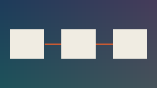

# Bilder

## Wiki-embed

![[arkitektur.png]]

## Med bredde

![[arkitektur.png|160]]

## Med alt-tekst og bredde

![[arkitektur.png|Arkitekturskisse|200]]

## Med mappesti

![[attachments/logo.svg]]

## Filnavn med mellomrom

![[diagram med mellomrom.png]]

## Svært bredt bilde

![[bred.png]]

Forventet: skaleres ned til innholdsbredden, ingen horisontal scroll (AK5).

## Markdown-bilde – relativ sti

## Markdown-bilde – vault-rot-sti

## Markdown-bilde – mellomrom (vinkelparentes og URL-koding)

## Brutt bilde

![[mangler.png]]

## SVG i domenemappen

![[domenemodell.svg]]
