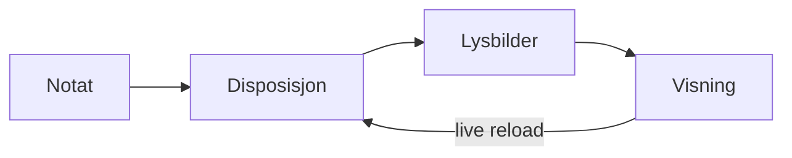

# Statusmøte uke 45

## Siden sist

### Leveranse A – lesekomfort

Lesekomfort (v1.1) er levert og akseptansetestet.

- Diskré embedding per notat
- Folding med `za`, `zM` og `zR`
- Zen-modus og lesebredde

Markør STATUS-A.

### Leveranse B – tastaturmotor

Tastaturmotoren har egne moduser. Utdrag fra registeret:

```ts
export const PRESENT_BINDINGS = {
  next: ['j', 'ArrowRight', 'n', 'Space', 'PageDown'],
  previous: ['k', 'ArrowLeft', 'p', 'PageUp'],
  first: ['g g'],
  last: ['G'],
};
```

Markør STATUS-B.

## Jobbes med nå

### Oppgaver

Tavlen under er levende data fra oppgavemappen (samme utvalg som Kanban-viewet i Oppgaver-basen).

```base
filters:
  and:
    - file.hasTag("task")
    - file.folder != "templates"
views:
  - type: kanban
    name: Statustavle
    groupBy:
      property: status
      direction: ASC
    groupOrder:
      - todo
      - doing
      - done
    order:
      - file.name
      - file.tags
```

### Flyt i presentasjonen



Markør STATUS-FLYT.

## Relativt nær framtid

### Plan Q1

| Måned | Leveranse | Ansvarlig |
|---|---|---|
| Januar | Presentasjonsmodus i produksjon | Kari |
| Februar | PDF-eksport (forstudie) | Ola |
| Mars | Presentatørvisning (forstudie) | Per |

Planen er foreløpig.[^plan] Detaljer i [[Månedsrapport oktober]].

[^plan]: Avhenger av kapasitet i plattformteamet.

Markør STATUS-PLAN.
