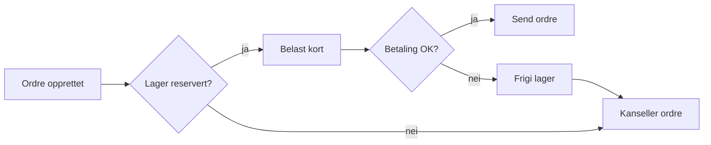

# Hendelsesdrevet arkitektur

Et langt notat med mange overskrifter på flere nivåer. Brukes til å teste **innholdsfortegnelse med scroll-spy** (AK16) og lenker til overskrifter.

## Motivasjon

Tjenester som kommuniserer synkront blir tett koblet i *tid*: hvis betalingstjenesten er nede, feiler ordre. Med hendelser kan ordre fortsette å ta imot bestillinger, mens betalingen tar igjen køen senere.

Det koster: vi får **eventual consistency**, flere bevegelige deler og vanskeligere feilsøking. Denne avveiningen er beskrevet i [[ADR-001 Bruk Kafka]].

## Begreper

### Hendelse

En hendelse er et *faktum* om noe som har skjedd, navngitt i preteritum: `OrdreOpprettet`, `BetalingMottatt`.

### Kommando

En kommando er en *forespørsel* om at noe skal skje: `ReserverLager`. Den kan avslås.

### Hendelsesbærende tilstand

Når hendelsen bærer nok data til at konsumenten slipper å spørre tilbake (event-carried state transfer).

## Mønstre

### Outbox-mønsteret

Skriv hendelsen til en `outbox`-tabell i **samme databasetransaksjon** som forretningsendringen, og la en relay publisere til Kafka. Se [[Transaksjoner i Spring#Transactional outbox]].

```sql
CREATE TABLE outbox (
    id          BIGSERIAL PRIMARY KEY,
    aggregat_id UUID        NOT NULL,
    type        TEXT        NOT NULL,
    payload     JSONB       NOT NULL,
    opprettet   TIMESTAMPTZ NOT NULL DEFAULT now(),
    sendt       BOOLEAN     NOT NULL DEFAULT false
);
```

### Saga

En saga koordinerer en forretningsprosess over flere tjenester med kompenserende handlinger.



#### Orkestrering

En sentral orkestrator sender kommandoer og lytter på svar.

#### Koreografi

Hver tjeneste reagerer på hendelser fra de andre. Ingen sentral koordinator.

### CQRS

Skill skrivemodell og lesemodell. Lesemodellen bygges fra hendelser og kan optimaliseres for spørringer.

## Feilhåndtering

### Retry med backoff

```java
@RetryableTopic(
    attempts = "5",
    backoff = @Backoff(delay = 1000, multiplier = 2.0, maxDelay = 30000),
    dltTopicSuffix = ".dlt")
@KafkaListener(topics = "handel.betaling.mottatt.v1")
public void håndter(BetalingMottatt hendelse) {
    betalingService.registrer(hendelse);
}
```

### Dead letter topic

Meldinger som feiler etter alle forsøk havner på `.dlt`. Noen må eie DLT-en og ha en rutine for å spille av på nytt.

### Giftmeldinger

En melding som aldri kan deserialiseres blokkerer partisjonen. Bruk `ErrorHandlingDeserializer`.

## Skjemaevolusjon

### Bakoverkompatibilitet

Nye felter må være valgfrie. Felter fjernes aldri – de avvikles.

### Versjonering i topic-navn

Vi bruker suffiks `.v1`, `.v2` når en endring ikke er kompatibel.

```json
{
  "$schema": "https://json-schema.org/draft/2020-12/schema",
  "title": "OrdreOpprettet",
  "type": "object",
  "required": ["ordreId", "kundeId", "tidspunkt"],
  "properties": {
    "ordreId":   { "type": "string", "format": "uuid" },
    "kundeId":   { "type": "string", "format": "uuid" },
    "tidspunkt": { "type": "string", "format": "date-time" }
  }
}
```

## Observerbarhet

### Korrelasjons-ID

Send `traceparent` som Kafka-header slik at spor henger sammen på tvers av tjenester.

### Konsumentetterslep

Overvåk *consumer lag* per partisjon. Varsle på trend, ikke på absolutte tall.

## Testing

### Kontraktstester

Produsent og konsument deler JSON-schema; begge sider tester mot det.

### Ende-til-ende

Få, men verdifulle. Kjøres mot Testcontainers-Kafka.

## Oppsummering

1. Hendelser gir løs kobling i tid – men koster konsistens.
2. Bruk outbox for å unngå dobbeltskriving.
3. Design for *minst én gang* og idempotens.
4. Ha en plan for DLT før du trenger den.

## Referanser

- [[Kafka-grunnleggende]]
- [[Consumer groups]]
- [[Ordre]] og [[Betaling]] i domenet
