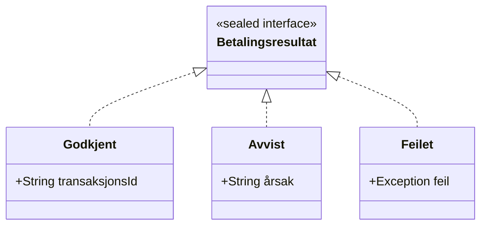

# Records og sealed interfaces

```java
public sealed interface Betalingsresultat
        permits Godkjent, Avvist, Feilet {}

public record Godkjent(String transaksjonsId) implements Betalingsresultat {}
public record Avvist(String årsak) implements Betalingsresultat {}
public record Feilet(Exception feil) implements Betalingsresultat {}

String beskriv(Betalingsresultat r) {
    return switch (r) {
        case Godkjent g -> "OK " + g.transaksjonsId();
        case Avvist a   -> "Avvist: " + a.årsak();
        case Feilet f   -> "Feil: " + f.feil().getMessage();
    };
}
```


