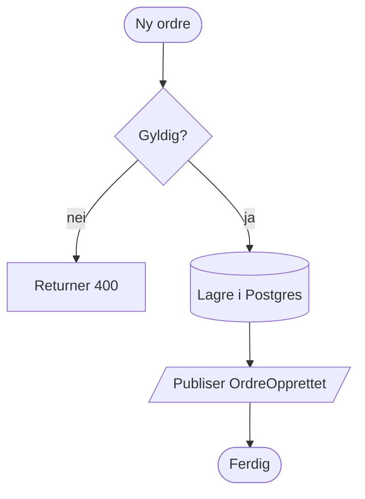
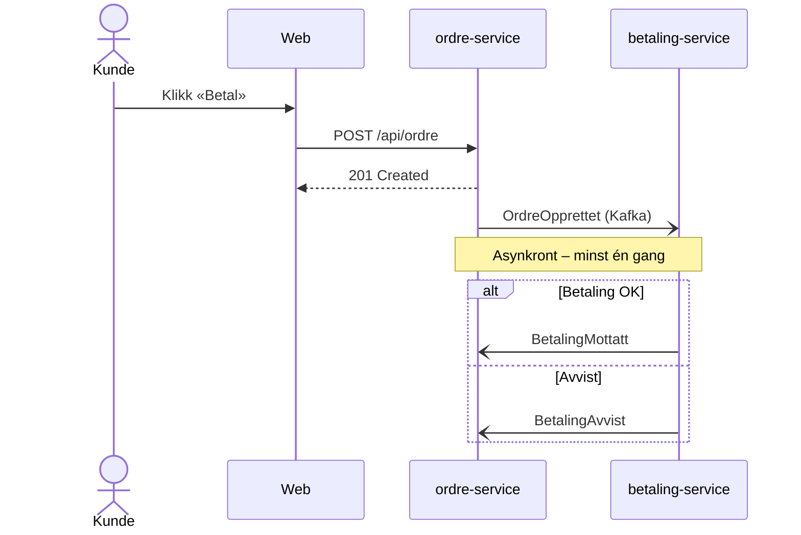
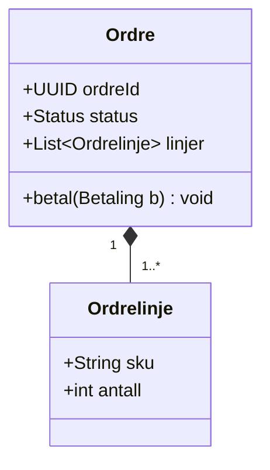
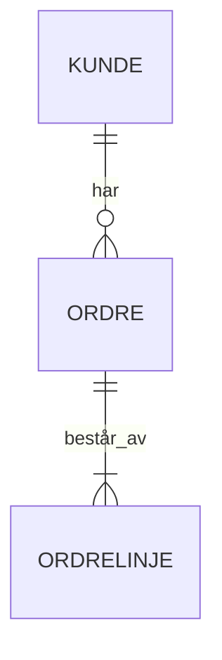
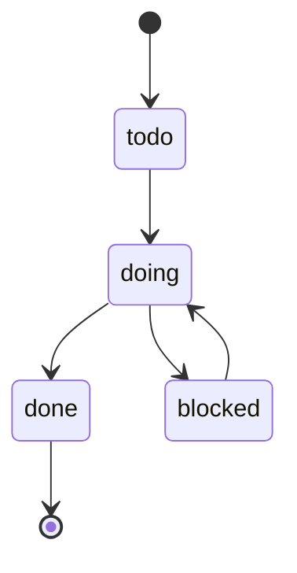
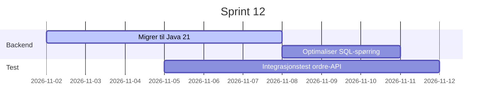
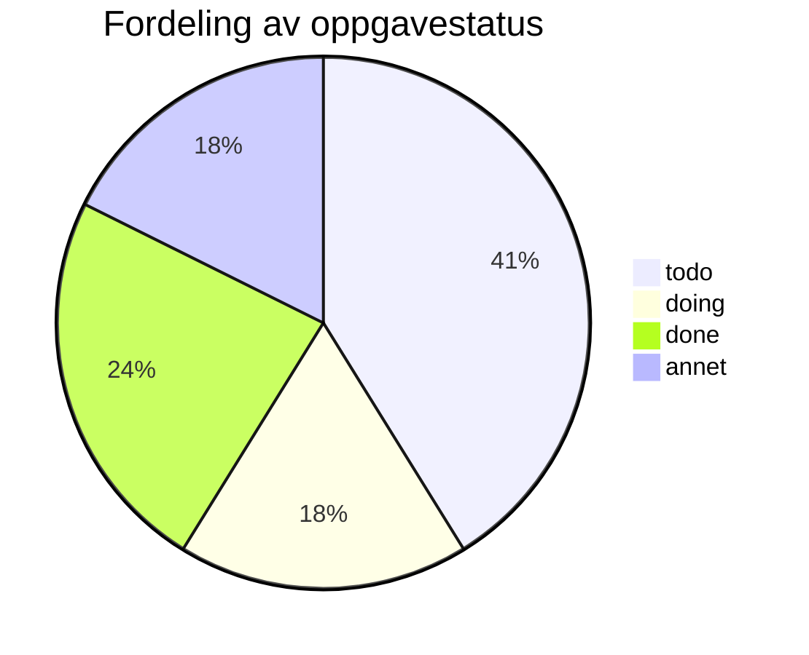

# Mermaid-galleri

Én av hver diagramtype. Alle skal følge temaet (lys/mørk) og re-rendres ved temabytte (AK15). Det siste er bevisst ugyldig.

## Flowchart



## Sekvensdiagram



## Klassediagram



## ER-diagram



## Tilstandsdiagram



## Gantt



## Ugyldig diagram

Forventet: en tydelig, men diskret feilmelding *i blokken* (f.eks. «Kunne ikke tegne diagrammet») med kildekoden synlig. Resten av siden skal rendres normalt, og Mermaid skal **ikke** legge igjen feil-SVG-er nederst i `<body>`.

```mermaid
flowchart LR
    A --> B -->
    C[[uavsluttet
    }}} dette er ikke mermaid
```

## Etter feilen

Denne seksjonen skal vises – en feil i ett diagram stopper ikke resten. Se også [[Stort mermaid-diagram]].


