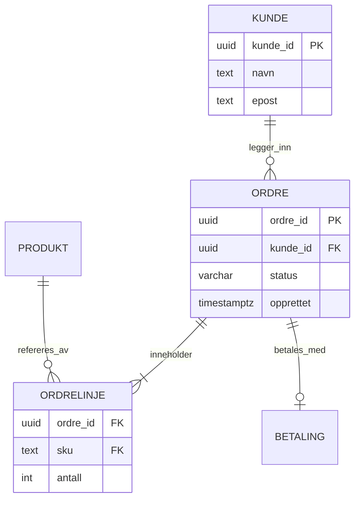

# Indekser i PostgreSQL

## B-tre

Standard. Støtter `=`, `<`, `>`, `BETWEEN`, `ORDER BY`.

## Delvise indekser

```sql
CREATE INDEX CONCURRENTLY idx_ordre_betalt_opprettet
    ON ordre (opprettet DESC)
    WHERE status = 'BETALT';
```

## Datamodell


