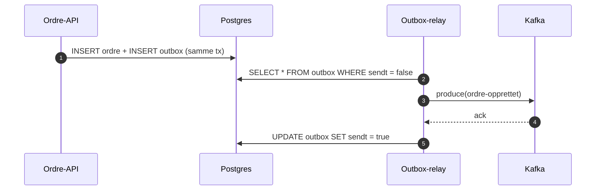

# Transaksjoner i Spring

`@Transactional` fungerer via proxy. **Kall fra samme klasse går utenom proxyen** og får ingen transaksjon.

```java
@Service
public class OrdreService {

    @Transactional
    public void opprett(NyOrdre ny) {
        repo.save(Ordre.fra(ny));
        intern(); // ⚠ ingen ny transaksjon her, selv med REQUIRES_NEW
    }

    @Transactional(propagation = Propagation.REQUIRES_NEW)
    void intern() { /* ... */ }
}
```

## Transactional outbox



Se [[Hendelsesdrevet arkitektur#Outbox-mønsteret]].
