# Stort mermaid-diagram

Et bevisst stort flytskjema (62 noder, 12 subgrafer). Forventet (AK15): rendres uten å sprenge layouten, kan **forstørres** (fullskjerm/zoom), følger tema, scroller internt på mobil.

```mermaid
flowchart TB
    subgraph ordre_ctx["Ordre-kontekst"]
        ordre_api["ordre-api"] --> ordre_svc["ordre-service"]
        ordre_svc --> ordre_db[("ordre-db")]
        ordre_svc --> ordre_out["ordre-outbox"]
        ordre_out --> ordre_relay["ordre-relay"]
    end
    subgraph betaling_ctx["Betaling-kontekst"]
        betaling_api["betaling-api"] --> betaling_svc["betaling-service"]
        betaling_svc --> betaling_db[("betaling-db")]
        betaling_svc --> betaling_out["betaling-outbox"]
        betaling_out --> betaling_relay["betaling-relay"]
    end
    subgraph lager_ctx["Lager-kontekst"]
        lager_api["lager-api"] --> lager_svc["lager-service"]
        lager_svc --> lager_db[("lager-db")]
        lager_svc --> lager_out["lager-outbox"]
        lager_out --> lager_relay["lager-relay"]
    end
    subgraph frakt_ctx["Frakt-kontekst"]
        frakt_api["frakt-api"] --> frakt_svc["frakt-service"]
        frakt_svc --> frakt_db[("frakt-db")]
        frakt_svc --> frakt_out["frakt-outbox"]
        frakt_out --> frakt_relay["frakt-relay"]
    end
    subgraph kunde_ctx["Kunde-kontekst"]
        kunde_api["kunde-api"] --> kunde_svc["kunde-service"]
        kunde_svc --> kunde_db[("kunde-db")]
        kunde_svc --> kunde_out["kunde-outbox"]
        kunde_out --> kunde_relay["kunde-relay"]
    end
    subgraph katalog_ctx["Katalog-kontekst"]
        katalog_api["katalog-api"] --> katalog_svc["katalog-service"]
        katalog_svc --> katalog_db[("katalog-db")]
        katalog_svc --> katalog_out["katalog-outbox"]
        katalog_out --> katalog_relay["katalog-relay"]
    end
    subgraph faktura_ctx["Faktura-kontekst"]
        faktura_api["faktura-api"] --> faktura_svc["faktura-service"]
        faktura_svc --> faktura_db[("faktura-db")]
        faktura_svc --> faktura_out["faktura-outbox"]
        faktura_out --> faktura_relay["faktura-relay"]
    end
    subgraph varsling_ctx["Varsling-kontekst"]
        varsling_api["varsling-api"] --> varsling_svc["varsling-service"]
        varsling_svc --> varsling_db[("varsling-db")]
        varsling_svc --> varsling_out["varsling-outbox"]
        varsling_out --> varsling_relay["varsling-relay"]
    end
    subgraph søk_ctx["Søk-kontekst"]
        søk_api["søk-api"] --> søk_svc["søk-service"]
        søk_svc --> søk_db[("søk-db")]
        søk_svc --> søk_out["søk-outbox"]
        søk_out --> søk_relay["søk-relay"]
    end
    subgraph anbefaling_ctx["Anbefaling-kontekst"]
        anbefaling_api["anbefaling-api"] --> anbefaling_svc["anbefaling-service"]
        anbefaling_svc --> anbefaling_db[("anbefaling-db")]
        anbefaling_svc --> anbefaling_out["anbefaling-outbox"]
        anbefaling_out --> anbefaling_relay["anbefaling-relay"]
    end
    subgraph rapport_ctx["Rapport-kontekst"]
        rapport_api["rapport-api"] --> rapport_svc["rapport-service"]
        rapport_svc --> rapport_db[("rapport-db")]
        rapport_svc --> rapport_out["rapport-outbox"]
        rapport_out --> rapport_relay["rapport-relay"]
    end
    subgraph revisjon_ctx["Revisjon-kontekst"]
        revisjon_api["revisjon-api"] --> revisjon_svc["revisjon-service"]
        revisjon_svc --> revisjon_db[("revisjon-db")]
        revisjon_svc --> revisjon_out["revisjon-outbox"]
        revisjon_out --> revisjon_relay["revisjon-relay"]
    end
    kafka{{"Kafka-klynge"}}
    ordre_relay --> kafka
    betaling_relay --> kafka
    lager_relay --> kafka
    frakt_relay --> kafka
    kunde_relay --> kafka
    katalog_relay --> kafka
    faktura_relay --> kafka
    varsling_relay --> kafka
    søk_relay --> kafka
    anbefaling_relay --> kafka
    rapport_relay --> kafka
    revisjon_relay --> kafka
    kafka -. "ordre.hendelser" .-> frakt_svc
    kafka -. "betaling.hendelser" .-> søk_svc
    kafka -. "lager.hendelser" .-> betaling_svc
    kafka -. "frakt.hendelser" .-> faktura_svc
    kafka -. "kunde.hendelser" .-> revisjon_svc
    kafka -. "katalog.hendelser" .-> kunde_svc
    kafka -. "faktura.hendelser" .-> anbefaling_svc
    kafka -. "varsling.hendelser" .-> lager_svc
    kafka -. "søk.hendelser" .-> varsling_svc
    kafka -. "anbefaling.hendelser" .-> ordre_svc
    kafka -. "rapport.hendelser" .-> katalog_svc
    kafka -. "revisjon.hendelser" .-> rapport_svc
    gw["API-gateway"]
    gw --> ordre_api
    gw --> betaling_api
    gw --> lager_api
    gw --> frakt_api
    gw --> kunde_api
    gw --> katalog_api
    gw --> faktura_api
    gw --> varsling_api
    gw --> søk_api
    gw --> anbefaling_api
    gw --> rapport_api
    gw --> revisjon_api
```

